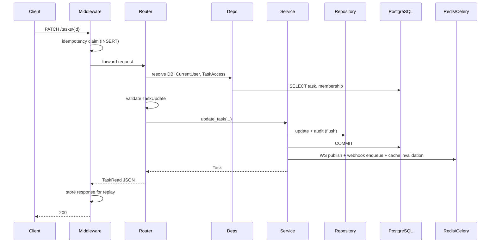

# 03 — Request Lifecycle

## Concept

One concrete request, followed end to end:

```
PATCH /api/v1/tasks/{task_id}  with {"status": "in_review"}
Authorization: Bearer <access JWT>
Idempotency-Key: abc123...   (optional)
```

Use this lesson as your map: later lessons zoom into each numbered step.

## The path (with real code)

### 1. ASGI server → middleware stack

`uvicorn` (or gunicorn+uvicorn workers) receives the request. TeamFlow's
middleware is assembled in `app/main.py`:

```python
app.add_middleware(RequestContextMiddleware)   # outermost: request id + access log
app.add_middleware(IdempotencyMiddleware)      # Idempotency-Key handling
app.add_middleware(CORSMiddleware, ...)        # CORS preflight + headers
```

Middleware added last runs first in Starlette's stack, so effective order is:
CORS → Idempotency → RequestContext → router. (Details and the exact semantics
in `fastapi/08-middleware.md`.)

### 2. RequestContextMiddleware — identity + timing

`app/core/middleware.py` assigns a request id (or reuses `X-Request-ID`), stores
it in a contextvar used by the logger, and records duration/status for the
access log. No DB, no Redis — it must be cheap for every request.

### 3. IdempotencyMiddleware — the claim

`app/core/idempotency.py` intercepts `POST/PATCH/DELETE` when the client sends
`Idempotency-Key`. It **reads the body once**, hashes it, and INSERTs a claim row
(`idempotency_keys`) *before the route runs*. A concurrent duplicate hits the
unique constraint → 409 (in flight) or replays the stored response. This is the
part most implementations get wrong; the design is dissected in
`infrastructure/09-webhooks.md`'s sibling lesson and in
`database/06-transactions.md`.

### 4. Routing

`app/api/router.py` includes every router with the `/api/v1` prefix from
`settings.api_v1_prefix`. FastAPI matches the path, extracts `task_id: UUID`
(path param), and starts **dependency resolution** before your function is
called.

### 5. Dependencies run (order matters)

From `app/api/deps.py` and the route signature:

| Dependency | Effect |
| --- | --- |
| `DB` | opens an `AsyncSession` bound to the engine (one per request) |
| `Token` → `CurrentUser` | decodes the JWT, loads the user, binds `user_id` to log context |
| `TaskAccess` | loads the task, then the caller's membership in the task's org |
| `Request` | raw request (used only for `ip`) |

`TaskAccess` is the tenant boundary: it fetches the task by id, resolves
`task.organization_id`, and checks `memberships` for the *authenticated* user.
Non-members get `NotFoundError` → 404, so ids cannot be probed
(`auth/07-multi-tenancy.md`).

### 6. Request validation

`TaskUpdate` is a SQLModel/Pydantic model. `{"status": "done"}` passes field
validation (`Literal` of the 4 statuses). An invalid value like `"archived"`
never reaches Python business code — FastAPI returns 422 with the sanitized error
shape installed in `app/core/exceptions.py`.

### 7. Service = business rules + authorization

`app/services/tasks.py`:

```python
if "status" in changed and data.status and data.status != task.status:
    allowed = STATUS_TRANSITIONS.get(task.status, set())
    if data.status not in allowed:
        raise ValidationFailedError(
            f"Cannot move task from '{task.status}' to '{data.status}'"
        )
    task.status = data.status
    task.completed_at = datetime.now(UTC) if data.status == TaskStatus.DONE else None
```

`changed = data.model_fields_set` distinguishes "field omitted" from "field set
to null" — the PATCH semantics problem (`fastapi/05-pydantic.md`).

### 8. Repository + transaction

Repositories only `flush`; the service commits **once**:

```python
task = await TaskRepository(db).update(task)
await audit.log(db, AuditAction.TASK_UPDATED, ...)   # same transaction
...
await db.commit()
```

Audit row and task update commit together or not at all.

### 9. Side effects after commit (deliberate order)

After the data is durable:

```python
task = await refetch_task(db, task.id)          # identity-map-safe refetch
payload = task_event_payload(task)
await events.publish_project_event(task.project_id, "task.updated", payload)
await events.dispatch_webhooks(db, organization_id=org.id, event=event_type, data=payload)
await cache.invalidate_dashboard(org.id)
```

- WS publish → Redis pub/sub → every worker's listener → connected sockets.
- Webhooks: delivery rows are committed *inside* `dispatch_webhooks`, then the
  Celery task is enqueued. A broker outage leaves rows `pending` for the sweeper
  instead of losing events.

### 10. Exception handling

Anything a service raises (`AppError` subclasses) is converted to JSON by
`install_exception_handlers` in `app/core/exceptions.py`. Unexpected exceptions
and `SQLAlchemyError` are logged with the request id and returned as a generic
500 — no stack traces to clients when `DEBUG=false`.

### 11. Response model filtering

`response_model=TaskRead` filters what leaves the API. `hashed_password` can
never leak because it is not in the schema, regardless of what the ORM object
contains. Nested `assignee`/`creator`/`labels` come from eager loading — there
is no hidden second query at serialization time (`database/08-loading-and-n-plus-one.md`).

### 12. Middleware unwinds

`IdempotencyMiddleware` captures the response (status < 500 → store for replay),
`RequestContextMiddleware` writes the access log line and resets the contextvar.

## Sequence diagram



## Production perspective

- **Multi-worker**: steps 9's Redis hop is what makes WS/webhooks work with N
  API workers — no in-process state is assumed.
- **Failure at step 8**: the transaction rolls back; no audit row, no events.
- **Failure at step 9** (Redis down): the API still returns 200; WS publish logs
  and continues; webhook rows stay `pending` (sweeper retries); dashboard cache
  invalidation is best-effort (TTL is the safety net).
- **Idempotent retry by the client**: step 3 replays the stored response with
  `Idempotency-Replayed: true` and the original status code.

## Common mistakes this design avoids

| Mistake | Consequence |
| --- | --- |
| Doing the tenant check in the router body | copy-paste drift; one forgotten endpoint leaks data |
| Publishing WS/webhooks before commit | clients act on data that later rolls back |
| Committing inside repositories | kills composition; partial writes on failure |
| Relying on lazy relationship loading | `MissingGreenlet` in async, or N+1 |
| Returning ORM objects without `response_model` | accidental data exposure |

## Review questions

1. At which step would a non-member's request terminate, and with what status?
2. Why does the audit row commit in the same transaction as the task change?
3. What exactly does the client get if it retries the same PATCH with the same
   `Idempotency-Key`? What if it changes the body?
4. Where would you add a new step (e.g., "notify watchers by email") and why
   there?
