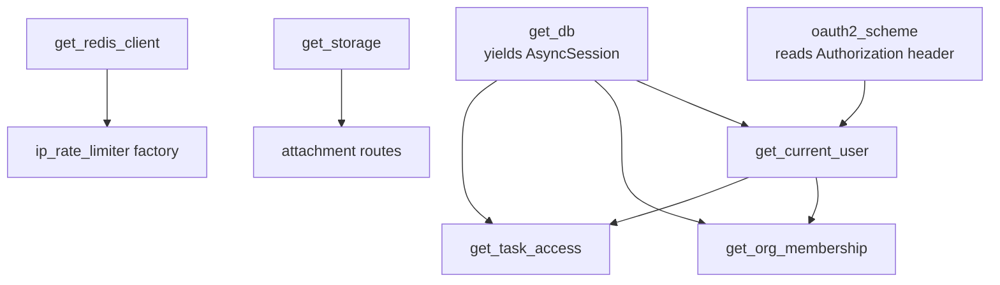

# Architecture 03 — Dependencies (as an architectural layer)

> FastAPI mechanics of `Depends` live in `fastapi/06-dependency-injection.md`.
> This lesson is about dependencies as an **architectural layer**: what belongs
> there, what must not, and how TeamFlow's dependency layer implements tenant
> isolation uniformly.

## Concept

The dependency layer answers: *what request-scoped context does the handler
need, and is the caller allowed to have it?* It returns data (models, clients)
or raises (401/403/404/429).

## The layer's two jobs

| Job | Examples | Reads DB? |
| --- | --- | --- |
| Provide context | `DB`, `CurrentUser`, `RedisDep`, `Storage` | session yes, others no |
| Guard access | `OrgMembership`, `TaskAccess`, `ProjectAccess`, `AttachmentAccess`, `CommentAccess`, `LabelAccess`, `ip_rate_limiter` | yes (membership row) |

Everything in `app/api/deps.py` is read-only: no inserts, no updates, no
commits. That invariant is what makes dependencies safe to run on every request
— they cannot partially mutate state and then fail.

## The access-dependency pattern (TeamFlow's signature move)

Five resources follow the identical three-step shape:

```python
async def get_task_access(task_id, current_user: CurrentUser, db: DB
) -> tuple[Task, Organization, Membership]:
    # 1. load the resource by id
    task = (await db.execute(select(Task).where(Task.id == task_id))).scalar_one_or_none()
    if not task:
        raise NotFoundError("Task not found")
    # 2. resolve the caller's membership in the resource's org
    membership = await MembershipRepository(db).get_for_user(current_user.id, task.organization_id)
    if not membership or not membership.is_active:
        raise NotFoundError("Task not found")     # 404, not 403
    # 3. return the *context triple* every service call needs
    org = await OrganizationRepository(db).get(task.organization_id)
    if not org:
        raise NotFoundError("Task not found")
    return task, org, membership
```

Why return a triple instead of just the task?

- The service signature `update_task(db, actor, org, task, data)` needs all
  three; passing them from a single dependency means the handler cannot
  accidentally call the service with a *different* org than the one the
  authorization check used. Authorization context and business inputs are the
  same object.
- It documents the cost: two queries per id-addressed request (resource +
  membership), both indexed.

The alias keeps signatures short:

```python
TaskAccess = Annotated[tuple[Task, Organization, Membership], Depends(get_task_access)]
```

## Dependency graph (actual)



Request-scoped caching means the graph's shared nodes (`db`, `current`) execute
once. The graph is shallow on purpose: each extra level is a query on every
request.

## What does **not** belong in dependencies

| Temptation | Why rejected | Where it belongs |
| --- | --- | --- |
| Role-rank checks (`if role < ADMIN`) | programmatic callers bypass them | services |
| Business mutations ("mark viewed") | read-only invariant broken; runs on failures too | services |
| External API calls | adds un-cacheable latency to every route using it | services, with explicit caching |
| Complex multi-table joins | dependencies should fetch the minimum context | repositories/services |
| Feature-flag writes | side effects in the guard layer | services |

Note the subtle one: **dependencies are allowed to check rank for cheap guards**
(`ip_rate_limiter`) but not to implement *rules* — the distinction is whether
the check needs the business state (service) or only the context (dependency).

## The rate-limiter factory: parameterized dependencies

```python
def ip_rate_limiter(scope: str, max_hits: int | None = None, window: int | None = None):
    async def _limit(request: Request, redis_client: RedisDep) -> None: ...
    return _limit
```

Used with different scopes per endpoint:

```python
@router.post("/register", ...)
async def register(..., _rl: None = Depends(ip_rate_limiter("register",
        settings.register_rate_limit_max, settings.register_rate_limit_window))): ...
```

The factory pattern is how the dependency layer parameterizes without
duplication. (`fastapi/07-advanced-dependencies.md` has the mechanics.)

## Dependency overrides as the test seam

Because `Storage` is always obtained via `Depends(get_storage)`, tests replace
the S3 client wholesale:

```python
app.dependency_overrides[get_storage] = lambda: FakeStorage()
```

No MinIO required, no monkeypatching internals. If a route had instantiated
`StorageClient` inline, this seam would not exist — that is the architectural
value of routing infrastructure through dependencies.

## Django/DRF comparison 🔵

| Django | TeamFlow dependency layer |
| --- | --- |
| `AuthenticationMiddleware` + `request.user` (global) | `CurrentUser` (per route, explicit) |
| DRF `permission_classes` (per view) | access dependencies (per route, data-returning) |
| `request.tenant` set by tenant middleware | `OrgMembership` dependency |
| `get_object_or_404` in the view | access dependency raises before the handler |
| Custom context manager per view | generator dependency |

The conceptual shift: in DRF, permission and lookup are *separate* (a
permission checks, the view looks up). In TeamFlow they are *fused* — the
lookup dependency performs the permission as a side condition, so you cannot
have one without the other.

## Production perspective

- **Cost accounting**: an id-addressed endpoint costs resource + membership
  queries before any work. That is the price of uniform tenant isolation;
  compared to the alternative (per-route ad-hoc checks) it is cheaper in bugs.
- **Failure codes from dependencies are the API's security perimeter**: 401
  (identity), 404 (tenant), 429 (abuse). Services add 403 (rank) and 422
  (rules). Mapping them consistently is what makes the error taxonomy
  reviewable (`fastapi/09-exception-handling.md`).
- **Rate-limit dependency ordering**: `ip_rate_limiter` runs before service
  logic and before password verification on login — dependencies execute in
  parameter order, so place guards deliberately.

## Common mistakes

1. **`Depends` used as a service locator**: injecting repositories into
   dependencies for anything beyond the access check. Keep it to context.
2. **Mutating in dependencies.** Even "harmless" writes run on every request
   *including ones that fail later* — partial state.
3. **Two sources of truth for the tenant.** If a handler receives both
   `OrgMembership` (slug path) and a body-supplied org id, the body one is a
   vulnerability. TeamFlow's schemas never carry org ids.
4. **Skipping the access dependency on "internal" routes** — every route that
   takes a resource id must go through one.
5. **Deep chains**: `Depends(A)` where A needs B needs C each adding queries.
   Flatten or combine.

## Cheat sheet

```python
# context (no checks)
DB, CurrentUser, RedisDep, Storage

# access guards (return context triple)
OrgMembership, ProjectAccess, TaskAccess, AttachmentAccess, CommentAccess, LabelAccess

# parameterized guards
Depends(ip_rate_limiter("scope", max_hits, window))
```

## Review questions

1. Why do access dependencies return `(resource, org, membership)` instead of
   just the resource?
2. Which dependency performs *authorization*, which performs *authentication*,
   and which performs *abuse control*?
3. Why must dependencies stay read-only?
4. What would break in the attachment tests if routes built `StorageClient`
   inline instead of via `Depends(get_storage)`?
