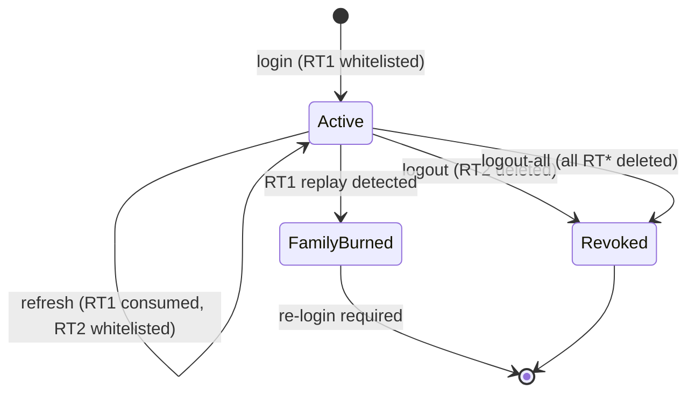

# Auth 04 — Access and Refresh Tokens

## Concept

Two-token design: a short-lived **access token** (stateless, carried on every
request) and a long-lived **refresh token** (stateful, used only to mint new
access tokens). TeamFlow's refresh tokens are JWTs whose `jti` is whitelisted
in Redis — enabling rotation, reuse detection, and real logout.

## Why two tokens

| Problem | Single long token | Access + refresh (TeamFlow) |
| --- | --- | --- |
| Token theft impact | full session lifetime | 30 minutes (access TTL) |
| Logout | impossible without state | revoke refresh JTI |
| Revocation | requires per-request Redis | only refresh path hits Redis |
| Storage on client | one token | two tokens |

The split keeps the hot path (every request) stateless while making session
control possible on the cold path (refresh every ~30 minutes).

## TeamFlow implementation

### Issuing — `app/services/auth.py`

```python
def _access_token(user: User) -> str:
    return security.create_token(str(user.id), security.TOKEN_TYPE_ACCESS,
                                 timedelta(seconds=ACCESS_TOKEN_EXPIRE_SECONDS))

def _refresh_token(user: User) -> str:
    return security.create_token(str(user.id), security.TOKEN_TYPE_REFRESH,
                                 timedelta(days=settings.refresh_token_expire_days),
                                 extra_claims={"jti": str(uuid.uuid4())})
```

On login, the refresh JTI is whitelisted:

```python
refresh = _refresh_token(user)
jti = jwt.decode(refresh, settings.secret_key, algorithms=[settings.jwt_algorithm])["jti"]
await token_store.store_refresh_token(redis, str(user.id), jti, REFRESH_TOKEN_EXPIRE_SECONDS)
```

### The store — `app/services/token_store.py`

```python
RT_PREFIX = "teamflow:rt"

def refresh_key(user_id: str, jti: str) -> str:
    return f"{RT_PREFIX}:{user_id}:{jti}"

async def store_refresh_token(redis, user_id, jti, ttl_seconds) -> None:
    await redis.set(refresh_key(user_id, jti), "1", ex=ttl_seconds)

async def is_refresh_token_active(redis, user_id, jti) -> bool:
    return await redis.exists(refresh_key(user_id, jti)) == 1

async def revoke_refresh_token(redis, user_id, jti) -> None:
    await redis.delete(refresh_key(user_id, jti))

async def revoke_all_refresh_tokens(redis, user_id) -> int:
    pattern = f"{RT_PREFIX}:{user_id}:*"
    deleted = 0
    async for key in redis.scan_iter(match=pattern, count=100):
        await redis.delete(key)
        deleted += 1
    return deleted
```

Key design points:

- **Key includes the user id** → `revoke_all` is a single pattern scan per user,
  no secondary index needed.
- **TTL mirrors token expiry** — Redis cleans up expired entries; the sweeper
  never has to.
- **`scan_iter`, not `keys`** — `KEYS` blocks Redis on large keyspaces;
  `SCAN` is incremental.
- **Values are `"1"`** — presence is the state; nothing sensitive is stored.

### Refresh with rotation — the security core

```python
async def refresh_tokens(db, redis, refresh_token) -> RefreshedToken:
    payload = decode(refresh_token)                       # signature + exp
    if payload.get("type") != security.TOKEN_TYPE_REFRESH:
        raise UnauthorizedError("Wrong token type; refresh requires a refresh token")

    jti, user_id = payload.get("jti"), payload.get("sub")
    user = await UserRepository(db).get(uuid.UUID(user_id))
    if not user or not user.is_active:
        raise UnauthorizedError("User no longer active")

    # Rotation: the presented token must still be whitelisted. A jti that is
    # gone means either expiry/rotation (normal) or replay of an old token
    # (attack) — we cannot tell which, so we burn the whole family.
    if not await token_store.is_refresh_token_active(redis, user_id, jti):
        await token_store.revoke_all_refresh_tokens(redis, user_id)
        logger.warning("Refresh token reuse detected; revoked session for user %s", user_id)
        raise UnauthorizedError("Refresh token expired or reused; please log in again")

    await token_store.revoke_refresh_token(redis, user_id, jti)      # consume
    new_refresh = _refresh_token(user)                                # rotate
    new_jti = decode(new_refresh)["jti"]
    await token_store.store_refresh_token(redis, user_id, new_jti, REFRESH_TOKEN_EXPIRE_SECONDS)
    await db.commit()
    return RefreshedToken(access_token=_access_token(user), refresh_token=new_refresh)
```

The **reuse detection** flow is the heart of the design:

```
legitimate client:  RT1 → (rotate) → RT2 → (rotate) → RT3
stolen RT1 replay:  RT1 is no longer whitelisted → revoke everything → 401
```

Burning the whole family means a thief holding a newer token is also locked
out — the client is forced to re-authenticate, and the theft becomes visible
(log warning + the user's session dies). Verified by
`tests/integration/test_auth_flow.py::test_refresh_rotates_and_old_token_dies`,
which asserts that after replaying the old token, the *new* token is dead too.

### Logout

```python
async def logout(redis, refresh_token) -> None:
    """Revokes exactly the presented refresh token. An invalid token is a
    no-op: logout must succeed even if the client already rotated."""
    try:
        payload = security.decode_token(refresh_token)
    except jwt.PyJWTError:
        return
    if payload.get("type") != security.TOKEN_TYPE_REFRESH:
        return
    user_id, jti = payload.get("sub"), payload.get("jti")
    if user_id and jti:
        await token_store.revoke_refresh_token(redis, user_id, jti)

async def logout_all(redis, user: User) -> None:
    await token_store.revoke_all_refresh_tokens(redis, str(user.id))
```

Logout is deliberately idempotent/no-throw: a client retrying logout (or
presenting an already-rotated token) must get 204, not 401 — otherwise clients
get stuck unable to log out.

### What logout does *not* do

Access tokens remain valid until `exp` (≤30 min). This is the documented
stateless trade-off: per-request revocation checks on every API call are the
alternative (Redis hit on 100% of traffic) and TeamFlow rejects that cost.
`logout-all` therefore guarantees "no *new* tokens can be minted from this
point", satisfying the common threat model (*lost device* → attacker's next
refresh fails, session ends within one access TTL).

## Full session state machine



## Django/DRF comparison 🔵

| simplejwt | TeamFlow |
| --- | --- |
| `RefreshToken.for_user()` | JWT with `jti` + Redis `SET ex` |
| `token.blacklist()` (Blacklist app, DB table) | Redis `DEL` (TTL-native, no cleanup job) |
| Rotation + blacklist after rotation | rotation + reuse detection (family revocation) |
| `SIMPLE_JWT["ROTATE_REFRESH_TOKENS"]` | always rotates |
| Session table | no session table — stateless access, Redis-tracked refresh |

The Redis-vs-DB choice for the whitelist: Redis gives TTL without a cleanup
job and sub-ms lookups on the refresh path — the ideal fit for ephemeral state.
The cost: a Redis flush logs everyone out (acceptable; not a source of truth
for anything else) and Redis must persist across restarts for smooth UX
(AOF enabled in both compose files).

## Production perspective

- **Losing the Redis whitelist** (flush without persistence): every refresh
  fails with reuse-detection semantics → users re-login. Recoverable, loud,
  and safe (fail-closed — a stolen old token can't be replayed either).
- **Multi-device**: each login creates its own JTI; `logout-all` covers all.
- **Token families** are per-login; a replay on one device revokes only that
  device's chain. (Stricter designs revoke the user's entire session graph —
  TeamFlow keeps per-login families and documents it.)
- **Race on refresh**: two parallel refreshes with the same RT — one wins
  rotation, the loser hits reuse detection and burns the family. Clients must
  serialize refresh calls (standard guidance); a grace window would be the
  production refinement.

## Common mistakes

1. **Storing refresh tokens in Redis without TTL** and needing a cleanup job.
2. **Returning a 401 on logout for an expired token** — clients stuck.
3. **Not rotating** — a leaked refresh token is valid for 14 days.
4. **Rotating without reuse detection** — rotation alone doesn't reveal theft;
   the whitelist check is what turns replay into a defense.
5. **Revoking on `refresh` from the access token** — wrong token class; the
   `type` check exists for this.

## Cheat sheet

```
login     → RT1 stored (ex=14d)
refresh   → RT1 exists? no → burn family, 401
            yes → DEL RT1, store RT2, return new pair
logout    → DEL presented jti (no-op on garbage)
logout-all→ SCAN+DEL teamflow:rt:{user}:*
```

## Review questions

1. Walk through what happens when an attacker replays a stolen RT1 after the
   victim already refreshed to RT2.
2. Why does logout never raise, even for a malformed token?
3. Why is the refresh whitelist in Redis instead of Postgres?
4. Trace two parallel refresh requests with the same token: who wins, who gets
   401, and why that is the safe outcome.
