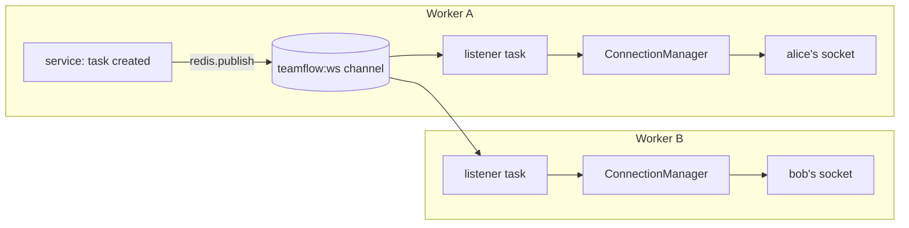

# Infrastructure 06 — WebSocket Scaling

## Concept

Stateful WebSocket connections + stateless, horizontally scaled API workers do
not naturally mix. TeamFlow solves it with Redis pub/sub: any worker can
publish; every worker's listener forwards to its local sockets.

## The problem, concretely

```
Without pub/sub:

Worker A (alice's socket)          Worker B (bob's socket)
       │                                  │
   task created by bob ─────────────────► B broadcasts to ITS sockets only
                                          alice (on A) never hears it
```

In-process broadcasting works perfectly until you run `--workers 2` — the
classic "works on my machine, silently drops half the events in prod" bug.

## The TeamFlow architecture



Every worker runs one `run_redis_listener` background task (started in lifespan)
and one `ConnectionManager` (local sockets only). Publishing goes to Redis from
wherever the business event happens — often a *service* in a request handler,
never the manager.

## The publish side — `app/services/events.py`

```python
WS_CHANNEL = "teamflow:ws"

async def publish(channel: str, event_type: str, data=None) -> None:
    payload = {"channel": channel,
               "event": {"type": event_type, "data": data or {}, "ts": now_iso()}}
    try:
        await get_redis_client().publish(WS_CHANNEL, json.dumps(payload))
    except Exception:
        logger.exception("Failed to publish realtime event %s", event_type)

async def publish_project_event(project_id, event_type, data=None):
    await publish(f"project:{project_id}", event_type, data)

async def publish_user_event(user_id, event_type, data=None):
    await publish(f"user:{user_id}", event_type, data)
```

Design notes:

- **One channel, room inside the payload.** Every worker receives every event
  and filters by its local rooms. Trade-off: O(workers × events) message
  parsing; fine at this scale. The upgrade is per-room channels with dynamic
  subscription (documented, not needed here).
- **Failure is logged, never raised.** Realtime is best-effort; a Redis hiccup
  must not fail a task creation.
- **Publishing is `await`ed inline** — it is a sub-millisecond Redis write, not
  background work (`fastapi/11`).

## The receive side — listener + manager

Listener (`app/websocket/router.py`):

```python
async def run_redis_listener(stop: asyncio.Event) -> None:
    while not stop.is_set():
        pubsub = None
        try:
            pubsub = get_redis_client().pubsub()
            await pubsub.subscribe(WS_CHANNEL)
            async for message in pubsub.listen():
                if message.get("type") != "message":
                    continue
                parsed = parse_redis_event(message.get("data"))
                if parsed is None:
                    continue
                room, event = parsed
                await manager.send_to_room(room, event)
        except asyncio.CancelledError:
            break
        except Exception:
            logger.exception("WS listener disconnected from Redis; retrying in 2s")
            await asyncio.sleep(2)
        finally:
            if pubsub is not None:
                try:
                    await pubsub.unsubscribe(WS_CHANNEL)
                    await pubsub.aclose()
                except Exception:
                    pass
```

Properties:

- **Reconnect loop** — a Redis restart degrades realtime for ~2s, then recovers.
  The API never dies.
- **Malformed messages are dropped** (`parse_redis_event` returns `None`) —
  bad data cannot kill the listener.
- **Clean unsubscribe/close** on cancel or error — no leaked pubsub objects on
  reloads.

Manager (`app/websocket/manager.py`):

```python
class ConnectionManager:
    def __init__(self) -> None:
        self._rooms: dict[str, set[WebSocket]] = {}
        self._lock = asyncio.Lock()

    async def send_to_room(self, room: str, event: dict) -> None:
        sockets = list(self._rooms.get(room, ()))
        dead: list[WebSocket] = []
        for socket in sockets:
            try:
                await socket.send_json(event)
            except Exception:
                dead.append(socket)
        for socket in dead:
            await self.disconnect(socket, room)
```

- **Per-process state only.** No cross-worker sharing — that is Redis's job.
- **Send failures prune sockets** — disconnected clients don't leak.
- **An `asyncio.Lock` serializes registry mutations** — two coroutines cannot
  corrupt the room sets.

## Room model

| Room | Subscribers | Events |
| --- | --- | --- |
| `project:{id}` | every member with the socket open | `task.created`, `task.updated`, `task.deleted`, `comment.created` |
| `user:{id}` | same socket, additional registration | `notification` |

One socket, two rooms: project events and personal notifications arrive on the
same connection.

## Scaling properties and limits (honest)

| Property | Status |
| --- | --- |
| N API workers | ✅ works by construction |
| Worker restart | clients reconnect (client-side); events during the gap are lost (no replay) |
| Event delivery guarantee | at-most-once, best-effort |
| Fan-out cost | every worker parses every event (one channel) |
| Slow client | `send_to_room` awaits each socket — a slow client can delay the room broadcast |
| Sticky sessions | unnecessary |

The two real limits to watch: **no replay** (a reconnect misses events during
the gap — clients should refetch state after reconnect) and **head-of-line
blocking on send** (fix with per-socket queues/timeouts at scale). Both are
documented trade-offs rather than accidents.

## Django/DRF comparison 🔵

| Channels | TeamFlow |
| --- | --- |
| Channel layer (`group_send`) | `redis.publish` + listener |
| `AsyncConsumer` per connection | `@router.websocket` handler |
| `group_add`/`group_discard` | `manager.connect/disconnect` room sets |
| In-memory layer (single process) | in-process manager (single process) |
| Redis layer (multi-process) | Redis pub/sub (multi-process) |

Channels' `channel_layer` abstraction formalizes exactly what TeamFlow builds
by hand: publish → shared store → per-process delivery. Building it manually is
the learning value here.

## Review questions

1. Why is broadcasting from `ConnectionManager` directly (without Redis) a bug
   in production but not in the test suite?
2. What happens to connected clients during a 2-second Redis outage?
3. Why does the manager prune sockets on send failure instead of relying on
   disconnect handlers?
4. Name the two honest delivery limitations of this design and the client-side
   mitigation for each.
