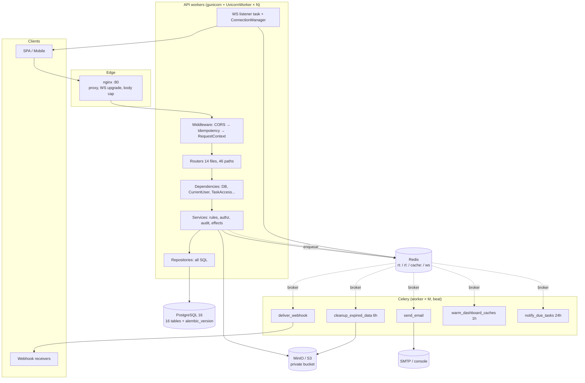

# Mastery 06 — Final Architecture (as Built)

This is the architecture as the code actually is — not as originally specified.
Differences from the original prompt are called out at the end.

## System diagram



## Request path summary

```
Client → nginx → middleware (id, idempotency, CORS)
       → router (HTTP shape) → dependencies (auth + tenant gate)
       → service (rules, authorization, ONE commit)
       → repository (SQL, flush) → SQLModel → PostgreSQL
       → after commit: WS publish (Redis) + webhook rows/enqueue (Redis→Celery) + cache invalidation
       → response_model → client
```

## Process inventory (production)

| Process | Command | State it owns |
| --- | --- | --- |
| nginx | `nginx` | TLS/HTTP routing, nothing stateful |
| api ×2 | gunicorn + UvicornWorker | engine pool, Redis client, WS sockets + listener |
| worker ×1 (concurrency 4) | `celery worker -Q default,emails,webhooks` | sync DB pool, shared httpx client |
| beat ×1 | `celery beat` | the schedule (must be exactly one) |
| postgres | `postgres:16-alpine` | source of truth |
| redis | `redis-server --appendonly yes` | ephemeral + derived state |

## Data ownership

| Data | Owner | Reconstruction |
| --- | --- | --- |
| Users, orgs, memberships, tasks, comments, labels, attachments (metadata), webhooks, deliveries, audit, idempotency | PostgreSQL | backups |
| Refresh whitelist, rate windows, dashboard cache, WS fan-out | Redis | rebuildable (sessions re-login; windows reset; cache recomputes) |
| Attachment bytes | S3/MinIO | uploads; rows + presigns survive, bytes are the asset |

## Deferred / divergent from the original spec (honest deltas)

| Original spec | As built | Why it matters |
| --- | --- | --- |
| `GET /tasks?...page=1` with page numbers | offset/limit (`Page[T]` envelope) | same semantics, explicit windowing; clients compute pages |
| `BackgroundTasks where appropriate` | none; Celery for all async work | durability + retries (`fastapi/11`) |
| "Password reset" endpoints | implemented (Redis single-use tokens + Celery email) | bonus vs spec |
| "Watchers if appropriate" | implemented (auto-watch + self endpoints) | |
| Notifications "background processing for delivery" | persisted inline, WS push inline, email via Celery | notifications are transactional; email is async |
| Webhook event `task.updated` distinction | `task.completed` emitted on transition to done, else `task.updated` | |
| "member.joined" WS event | notification to the joiner; no project-room broadcast | org membership isn't project-scoped |
| Token strategy "logout according to chosen strategy" | access JWT stateless (≤30 min), refresh revoked immediately | documented trade-off (`auth/04`) |
| Metrics/observability beyond logs | logs + health only | gap listed in `mastery/10` |

## The five invariants the architecture protects

1. **Tenant isolation** — server-resolved membership; 404 doctrine.
2. **Atomic business writes** — service-owned commits; audit in-transaction.
3. **Durable asynchronous work** — rows before enqueues; sweepers compensate.
4. **Multi-worker correctness** — no in-process business state; Redis for
   shared ephemeral state.
5. **Stateless API processes** — any worker can serve any request; scale is
   additive.

Every review question in this course can be re-derived from these five.

## Review questions

1. Which invariant would a "just broadcast in-process" change violate?
2. Which invariant explains why the idempotency claim commits separately?
3. If you added a second Celery worker queue for AI jobs, which invariants
   stay untouched?
4. Which three deltas from the original spec are improvements, and which are
   scope reductions?
