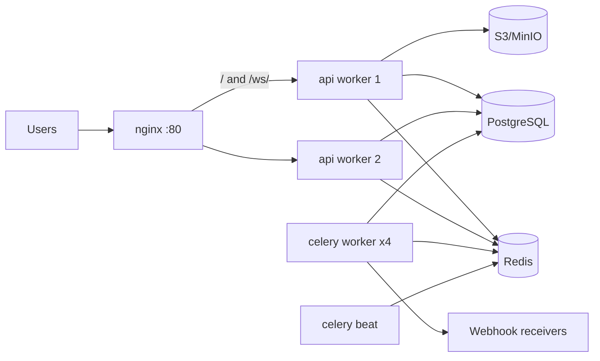

# Production 08 — Deployment

## Concept

Deployment for TeamFlow is: build an image → run migrations → start the six
processes → verify health → monitor. This lesson wires the pieces from the
other production lessons into one runbook.

## The production topology



## Step 1 — Configuration

```bash
cp .env.example .env       # then fill real values (or inject via secret store)
# required in production:
#   POSTGRES_USER/PASSWORD/DB, SECRET_KEY, DATABASE_URL/DATABASE_URL_SYNC,
#   REDIS_URL, CELERY_*, S3_*, (SMTP_* if EMAIL_BACKEND=smtp)
```

`docker compose -f docker-compose.prod.yml config` fails fast if the `:?`
guards are unsatisfied — run it once before deploying.

## Step 2 — Migrations (explicit, before the app rolls)

```bash
docker compose -f docker-compose.prod.yml run --rm api alembic upgrade head
```

Why not in the API command (unlike dev): with multiple API replicas, N
containers racing `upgrade head` is a foot-gun; migrations are a one-shot step
with a known order. The image contains `migrations/` and `alembic.ini` for this.

Migration discipline:

- **All schema changes go through Alembic** — `create_all` exists only for the
  test suite (`app/core/db.py` docstring).
- **Zero-downtime pattern**: add nullable column → deploy code writing both →
  backfill → add constraint in a later migration. Destructive changes
  (drops/renames) go in a *second* deploy after the old code is gone.
- **Verify** on a scratch database before production:
  ```bash
  alembic upgrade head && alembic downgrade base && alembic upgrade head
  ```
  (This exact cycle was run against `tf_migrate_check` during the build; the
  single initial migration is reversible.)

## Step 3 — Build and start

```bash
docker compose -f docker-compose.prod.yml build
docker compose -f docker-compose.prod.yml up -d
docker compose -f docker-compose.prod.yml ps        # expect: db/redis healthy, api/worker/beat/nginx up
```

Startup ordering is enforced by health-gated `depends_on` (db/redis), so the
API never boots against a half-ready database.

## Step 4 — Verify

```bash
curl -fsS http://<host>/api/v1/health/live    # process up
curl -fsS http://<host>/api/v1/health/ready   # db + redis ok
curl -fsS http://<host>/openapi.json | python -c "import json,sys; print(len(json.load(sys.stdin)['paths']), 'paths')"
```

Plus a five-minute smoke: register → login → create org/project/task → move
status (illegal move must 422) → dashboard 200 (the flow exercised during this
project's final validation).

## Step 5 — Observability handoff

- Logs: stdout in JSON (`LOG_JSON=true`) → platform collector. Every line
  carries `request_id`, `user_id`, `org_id`.
- Alerts to configure (derived from what exists): `/ready` failing at the LB;
  rate of 5xx in the access log; Celery queue depth; stale `pending`
  `webhook_deliveries` count (the sweeper should keep it near zero).
- Dashboards: none shipped (documented gap —
  `production/06-logging.md`).

## Rollback

| Scenario | Action |
| --- | --- |
| Bad app version | `docker compose ... up -d --build` with previous tag; migrations are backward-compatible by the two-phase discipline above |
| Bad migration (additive) | code rollback first; drop the column in a follow-up migration |
| Bad migration (destructive) | restore from backup (test the restore path!) |
| Redis lost | cache/limits reset; refresh tokens invalid → users re-login (fail-closed, `infrastructure/01`) |

## Backup/retention checklist

| Asset | Backup | Retention |
| --- | --- | --- |
| PostgreSQL | `pg_dump`/WAL archiving | per policy; audit_logs cascade on org delete (`auth/07`) |
| Redis | AOF (compose enables it) | rebuildable; not a source of truth |
| S3 objects | bucket versioning at the storage layer | orphaning gaps documented (`infrastructure/07`) |

## Django/DRF comparison 🔵

The runbook is nearly identical to a Django+DRF deploy (gunicorn, Celery,
nginx, migrations): the differences are `alembic upgrade` instead of
`manage.py migrate`, and workers running `UvicornWorker`. If you have deployed
Django in production before, you already know this shape.

## Common mistakes

1. **Migrations inside every API replica's boot command** — races and partial
   upgrades.
2. **`create_all` in production** — schema drift with no version history.
3. **Editing the initial migration after it shipped** — write a new one.
4. **Deploying without running the smoke flow against the new version.**
5. **No restore drill** — an untested backup is a hope, not a plan.

## Review questions

1. Why is `alembic upgrade head` a separate step in production but in the dev
   API command?
2. Walk the two-deploy pattern for renaming a column.
3. What should an operator check first when `/ready` returns 503 but `/live` is
   green?
4. Which data assets are rebuildable and which require real backups? Why?
